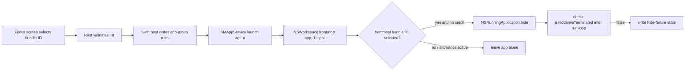

# Bloom macOS architecture inventory

**Audit date:** 2026-11-12
**Scope:** `bloom-exercise/` macOS desktop implementation and Bloom Supabase migrations in the workspace.
**Evidence labels:** **Verified** = source/platform evidence was read; **Observed** = recorded test note; **Unverified** = no adequate execution evidence; **Blocked** = required environment or evidence is unavailable.

## Executive map

| Subsystem | Entry points and source | Current design | Status |
|---|---|---|---|
| UI and account | `src/app/(app)/_layout.tsx`, `src/components/macos-focus.tsx`, `src/lib/auth.tsx`, `src/lib/bloom-context.tsx` | Expo Router / React Native Web focus screen; Supabase JS provides signed-in account, settings, balance, and rules | Verified from source |
| Tauri bridge | `src-tauri/src/lib.rs`, `src-tauri/macos/BloomFilterHost.swift` | One custom `macos_filter` command sends bounded JSON to an in-process signed Swift dylib. Rust validates actions, list sizes, UUIDs, credit duration, and token length. | Verified from source; runtime trust boundary not verified |
| Website filter | `macos/BloomFilterController.swift`, `macos/filter/BloomFilterDataProvider.swift`, `WebsiteRules.swift`, `TLSHostname.swift`, `MacFlowSource.swift`, `MacPolicyBroker*.swift` | `NEFilterManager` configures a content filter system extension; data provider filters visible hostnames and some TCP/TLS SNI flows. A same-team XPC policy broker bridges the per-user monitor and root filter; the filter drops a hostless flow only when its source matches a recent monitor signal for the foreground browser on a blocked address. | Notarized host 0.1.0/filter 1.1.7 helper-refresh build is installed; filter is activated/enabled and Bloom reports the website filter and monitor ready. In a fresh Brave Private window, `example.org` loaded as control and the blocked `example.com` target also loaded. Immediate blocking failed; delayed hide and exact network-flow cause remain unverified |
| Browser fallback | `macos/BloomAppMonitor.swift`, `MacBrowserAddress.swift`, `MacBrowserURL.swift`, `MacMonitorRules.swift`, `BloomPolicyBroker.swift` | `SMAppService` launch agent polls frontmost app once per second, reads active browser address through Apple Events or Accessibility, and hides a recognized browser when the address is unreadable or blocked. It publishes short-lived policy snapshots to an in-memory root LaunchDaemon over same-team XPC. | Source now fingerprints the bundled monitor and broker executables and re-registers stale helpers from the current signed app. The helper-refresh build replaced both running helper processes; the Focus screen reported both services ready and Brave's address readable before the test. Brave Private still rendered the target on the first observation; no flow rows were available to identify the path, and no delayed hide result was captured |
| App blocking | `BloomAppMonitor.swift`, `MacAppRules.swift`, `BloomAppController.swift` | Bundle-ID rules; frontmost app checked; `NSRunningApplication.hide()` is attempted and its result is checked after a run-loop turn. Process is not killed. | Source verified; prior live monitor failure documented |
| Hard/Super Hard credits | `SupabaseCreditGrant.swift`, `BloomFilterHost.swift`, `FilterCreditClock.swift`, `BloomFilterController.swift`, `BloomAppController.swift`; SQL migrations `20261101133510...`, `20261101210152...` | Signed native bridge obtains owner-bound server lease; server chooses remaining duration; native process converts it to a boot-bound monotonic deadline stored in filter config and app-group preferences. | Source and focused tests verified; installed-build expiry/recovery unverified |
| Easy timed access | `MacUsageStore.swift`, monitor, iOS/Android `UsageTracker` state, Focus screens; SQL `20261111000001_bloom_server_timed_easy.sql` | Database creates an access window from its own reservation timestamp, ending at the earlier of reserved duration or credit-bucket expiry. Settlement ignores client duration and charges server elapsed time. Local state only controls local enforcement. | Full SQL fixture set passed in a temporary PostgreSQL 14.21 cluster; native state fixtures passed. Not deployed or live-platform verified; this measures access-window duration, not foreground activity or attention |
| Sync and rules | `src/lib/blocking-rules-sync.ts`, Bloom SQL migrations, NE manager preferences, app-group defaults | Database stores account-scoped rules and credits; local website/app rules are synchronized to per-Mac enforcement state. | Simulated database tests exist; current physical sync not verified |
| Build/signing | `scripts/build-macos-filter.cjs`, `scripts/sign-macos-app.cjs`, `src-tauri/tauri.conf.json`, entitlement plists | macOS arm64/x86_64 native pieces; Developer ID profiles and signing checks; system-extension installation entitlement; notarization is a separate step. | Host 0.1.0/filter 1.1.7 local-Supabase helper-refresh build was accepted by Apple, stapled, and Gatekeeper-assessed as Notarized Developer ID. Strict nested-code verification passed. Its Brave Private target/control result is recorded separately and failed for immediate blocking |
| Persistence/recovery | NE provider configuration; app-group `UserDefaults`; `MacUsageStore` JSON + file lock; AsyncStorage owner marker | Network deadlines, rules, monitor heartbeat and local usage state use separate stores. Reboot recovery for Hard/Super Hard re-queries server by stable request/device ID; Easy interruption closes journal for settlement. | Source verified; failure/reboot behavior not verified live |

## Actual flows

### Website rule flow

```mermaid
flowchart LR
  UI[Focus screen] -->|macos_filter start, domains| Rust[Rust command validation]
  Rust --> Bridge[Signed Swift bridge]
  Bridge --> Manager[NEFilterManager preferences]
  Manager --> Ext[Global content-filter system extension]
  Ext --> Flow[New network flow]
  Flow --> Host{URL host or remote hostname?}
  Host -->|yes| Rule[WebsiteRules suffix match]
  Host -->|no hostname, matching fresh browser marker| Browser[Drop hostless flow from blocked foreground browser]
  Host -->|no hostname, otherwise TCP port 443| TLS[TLS ClientHello SNI peek]
  TLS --> Rule
  Host -->|no/UDP/ECH/other and no matching browser marker| Allow[allow unidentified flow]
  Rule -->|blocked, no allowance| Drop[drop flow]
  Rule -->|allowance or not blocked| Pass[pass inspected bytes]
  Monitor[LaunchAgent: foreground app + address] -->|short-lived state, same UID| Broker[In-memory root policy broker]
  Broker -->|snapshot for flow source UID| Flow
  Monitor -->|blocked or unreadable recognized browser| Hide[attempt to hide whole browser]
```



The data provider receives socket/WebKit flows, not browser tab state or page contents. Filter extensions run as root; the Bloom monitor runs as the user. The same-team XPC broker keeps per-UID snapshots in memory and lets only the signed root filter read them. Filter 1.1.10 adds a last-known snapshot fallback only for foreground browser enforcement after a broker request fails; it requires the same UID and boot, protection still enabled, a fresh monitor, and a cache age no greater than the existing 2.5-second active-browser marker. Website usage grants still require a live broker snapshot. Native policy checks pass, but this fallback is not live-verified: the installed 1.1.9 extension remains active and the 1.1.10 app opened to sign-in before it could refresh the monitor. A privacy-safe capture during a Brave foreground reload included hostless UDP allows and a broker-snapshot-unavailable allow, but the logs intentionally omit host and process identity, so those flows cannot be attributed to `example.com`. Unknown source tokens remain allowed to avoid disrupting unrelated apps; QUIC/UDP, ECH, existing connections, and browser-hide failure remain limitations.

### App enforcement flow



This hides the app and its windows; it does not terminate the process. `hide()` is documented as an attempt that returns whether hiding succeeded. The code now verifies a later hidden/terminated state, but user-interface changes may be visible during the polling/verification gap and repeated launches can race the one-second polling interval.

### Credit modes

```mermaid
sequenceDiagram
  participant UI as Focus UI
  participant N as Native Tauri bridge
  participant DB as Supabase
  participant E as Filter/monitor
  UI->>N: request ID, device key, minutes, current access token, targets
  N->>N: validate bounds; ignore renderer duration/deadline
  N->>DB: bloom_start_enforced_credit_session
  DB->>DB: lock user's settings; idempotent request/device ownership; calculate server expiry
  DB-->>N: session ID + authoritative remaining milliseconds
  N->>E: set boot-bound monotonic deadline
  E->>E: allow until deadline; then deny again
  Note over UI,DB: Easy mode uses a separate reservation; finish settles from server timestamps. Legacy p_used_ms input is ignored.
```

Hard-mode daily allowance is calculated in SQL as weekly earned positive ledger entries divided by seven, bounded by balance, earliest-expiry bucket, configured local day end, and credit expiry. Super Hard additionally takes the minimum with `super_daily_cap_minutes`. The stored `credit_timezone` defines day/week boundaries. SQL row locks and device-key hashes protect reservations against races and request replay. The full local SQL suite passed against a temporary PostgreSQL 14.21 cluster; the Docker-backed runner and remote service were not tested.

Easy mode meters elapsed time from the server-created reservation until the user finishes or the server-computed access deadline arrives, capped by the reserved duration and underlying credit expiry. Inactivity, app switching, device sleep, and app closure do not pause the billable window. The database computes the debit and ignores both the new clients' omitted duration and the legacy `p_used_ms` compatibility argument. This is verifiable measurement of the access grant's elapsed time; it does **not** prove which app was foreground, whether a page was interacted with, or whether the user was attentive. Local timers are enforcement aids and do not determine the ledger debit.

## Processes, persistence, and IPC

| Owner | State/data | Recovery behavior | Main limit |
|---|---|---|---|
| Supabase | Account identity, rules, settings, credit ledger, countdown/usage reservations | Request IDs are idempotent; countdown retries bind request + device + minutes; DB locks serialize account reservations | Server correctness does not prove a local OS policy was enforced |
| NEFilterManager | Provider identifier, enabled flag, blocked domains, credit deadline in vendor configuration | Host reloads preferences; filter can be activated through System Extension API | `isEnabled` is configuration state; no provider-healthy acknowledgement is exposed to host |
| App group | Monitor heartbeat/path, app rules, browser status, credit deadline, usage files | Host compares current monitor executable path and heartbeat; usage journal closes after interruption | Shared preferences/files are mutable by the logged-in standard user; provider is read-only for app-group data under Apple's filter sandbox model |
| AsyncStorage | Per-user request IDs, target set, device key, Hard recovery marker; no access token | Authenticated app startup/foreground/online retries same server request; native blocks while lease is unvalidated | Renderer/local storage is editable; recovery cannot prove a local past block interval |
| macOS TCC / Service Management | Accessibility, Apple Events approval, launch-agent registration, system-extension approval | UI can report approval/monitor states and request setup | Approval is user-controlled; service registration does not itself prove enforcement works |

## Platform/deployment map

| Capability | Evidence in repo | Required/observable condition | Status |
|---|---|---|---|
| Network Extension content filter system extension | `Host.entitlements`, `filter.entitlements`, `BloomFilterController.swift` | `content-filter-provider-systemextension`; signed host/filter/team/profiles; user approval; system extension successfully activated | Required entitlement code is present; live test history includes past `code signature invalid`, later activation; current installation identity not inspected |
| System extension install | Host entitlement `com.apple.developer.system-extension.install` | Embedded app can request install/activation; system approval and valid signed artifact | Build script checks profile entitlement; current artifact not verified |
| App Group | host, agent, filter entitlements | Team-prefixed `$(TeamIdentifierPrefix)com.nashaat.bloomexercise`; required for shared prefs/files | Source configuration present; packaging must verify exact team on each artifact |
| Accessibility | TCC consent requested/read through AX APIs | Required for browser address fallback and app monitor flows; permission is revocable | Live historical note reports a revoke/restore once; that did not verify blocking under loss |
| Apple Events automation | host/agent entitlement + `NSAppleScript` | macOS Automation approval may be needed per browser | Status read from AppleScript error; per-browser permission matrix unverified |
| Background execution | `SMAppService.agent`, bundled LaunchAgent | User approves Login Item; executable path and heartbeat match expected build | Prior stale Test 12 monitor caused false readiness; path matching now reduces stale-process risk; broad lifecycle remains unverified |
| Hardened runtime, Developer ID, notarization | Tauri config/scripts | Developer ID App certificate; provisioning profiles for relevant app IDs; entitlements; notarization/staple/assessment | 1.1.6 local artifact is signed, notarized, stapled, installed, and accepted by Gatekeeper. Current archive/hash are recorded in `../macos-verification.md` |
| Screen Recording / Screen Time | none found in Mac implementation | Not used by current Mac architecture | Not required by inspected Mac code |
| Privileged helper/root daemon | `BloomPolicyBroker.swift`, `BloomPolicyBrokerController.swift`, generated LaunchDaemon plist | Same-team signed monitor publishes only its own UID snapshot; only same-team root filter can read a UID snapshot; macOS reports daemon approval status | Source and deterministic access tests pass; service is not registered/approved or live-tested. It carries no persistent history and performs no network filtering itself |

Apple documents macOS content-filter system extensions from macOS 10.15 and notes that system extensions run globally and independently of the logged-in user. Bloom declares macOS 13.0 minimum. Therefore a dedicated macOS test account isolates profile data but **does not isolate a system content filter from other accounts on that Mac**. Apple's filter data provider runs in a restrictive sandbox and receives read-only app-group access; the host may publish rules, while provider must not write its own telemetry into that group. The new root broker avoids reading app-group state and keeps the cross-user policy snapshot in memory; approval and global-service effects still require testing. Sources: [Apple TN3134](https://developer.apple.com/documentation/technotes/tn3134-network-extension-provider-deployment), [Apple Content Filter Providers](https://developer.apple.com/documentation/networkextension/content-filter-providers).

## Security and observability findings

- **Verified:** `tauri.conf.json` has `csp: null`. Tauri's own documentation says CSP protection is enabled only when configured and recommends restricting hosts. This is a webview attack-surface gap because the renderer can invoke the custom protection command and holds an authenticated session. Exact safe allowlist needs the deployed Supabase origin and successful static export/CSP validation; no speculative CSP was added. [Tauri CSP](https://v2.tauri.app/security/csp/)
- **Verified:** `src-tauri/capabilities/default.json` exposes `core:default`; Rust registers one custom command with action validation and input-size bounds. No shell/plugin command appears in the capability file. Tauri capabilities are per-window API permission scopes. [Tauri Capabilities](https://v2.tauri.app/security/capabilities/)
- **Verified:** no secret key is embedded by design; build/sign scripts require a public Supabase publishable/anon key in signed app metadata and reject secret/service-role-looking keys. Runtime user bearer token is passed transiently to native URLSession and not written to disk or logs.
- **Verified:** filtering log includes no URL/domain telemetry. Monitor logs service startup and failed heartbeat, not browser history.
- **Verified gap:** website `status` reads `NEFilterManager.isEnabled`, not provider health. UI wording now says “Enabled · filter configured”; that is configuration status only.
- **Verified gap:** Easy usage can be forged by the signed-in account on a standard-user Mac by altering local state or invoking the RPC with an artificially low used value. This audit does not claim administrator/root resistance.

## Inventory limitations

The current source builds host version 0.1.0 with filter 1.1.10. The signed app was accepted by Apple, stapled, passed stapler validation, strict code-sign verification, and Gatekeeper assessment, then installed at `/Applications/Bloom Exercise QA 1.1.10 Broker fallback.app`. On launch it showed the sign-in screen; the monitor path still points to the 1.1.9 app, and `systemextensionsctl` reports 1.1.9 active/enabled while 1.1.10 is not registered. No 1.1.10 browser enforcement is verified. The notarized 1.1.9 app remains installed as the rollback copy.
